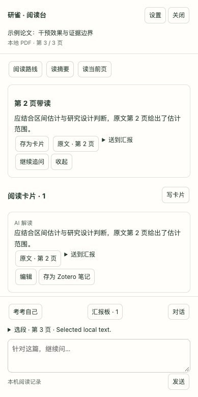

# 研雀 · LitFinch for Zotero

研雀 · LitFinch 的独立 Zotero 客户端，原名 PaperMind Connector。沿用原插件 ID、连接配置、登录凭据存储和阅读目录，不迁移或改写已有记录。

LitFinch for Zotero 在 Zotero 本地 PDF 旁提供阅读台：带读、追问、卡片、自测和单篇汇报。PDF 与阅读记录由个人保管；AI 使用个人 API 或官方 Codex 登录本人 ChatGPT 订阅。

在线体验：[研雀](https://papermindapp.com/welcome) · [免登录试读](https://papermindapp.com/demo) · [网站源码](https://github.com/lvyrana/papermind-source) · [插件下载](https://github.com/lvyrana/papermind-zotero/releases)

当前源码版本：**0.8.0（预发布）**。公共免费 AI 已取消，默认服务的右键入口打开本地阅读台，停止向公共网站上传 PDF。旧云端资料仍可在网站查看、导出和删除。主站自动更新清单保持原版本；原生安装、个人 API 真实生成及 Codex 登录仍待验收。[版本说明](RELEASE_NOTES.md)

> 旧版 0.7.1 已完成 macOS / Zotero 9.0.6 的网站登录与上传验收，不能据此推断 0.8.0 的个人 AI 登录也已通过。历史变更见 [CHANGELOG](CHANGELOG.md)。

原网站连接与上传代码保留供已有自建服务兼容，默认公共站的入口转为本地阅读。升级保留原账号标识和阅读文件，不清除既有记录。

实机验证范围：**macOS / Zotero 9.0.6**，已完成真实登录、完全退出进程后恢复、2.94 MB PDF 上传、网页读回及退出撤销，本机阅读文件不变。6 MiB 上传另在 Node 模拟宿主完成真实 HTTP 测试；Windows、Linux、Zotero 7/8 和其他 9.x 版本尚未原生验收。安装清单的兼容范围不等于上述平台全部测试通过。

## 阅读台预览

从当前论文进入带读，保留原文页码，再整理为卡片和汇报材料。



截图来自当前阅读台组件；论文和回答使用合成演示内容，Zotero 宿主由测试模拟。它展示界面，不作为真实 AI 输出或用户反馈。截图来源见 [说明](docs/screenshots/README.md)。

## 当前能力

- 空阅读台提供起步提示：有摘要时推荐「读摘要」，缺摘要时推荐从本地 PDF 生成「阅读路线」，PDF 未打开时提示补齐内容。已有带读、卡片、汇报、自测、对话、选段或草稿时让出界面；仅显示提示，不自动调用 AI 或写入阅读记录。
- 「连接个人 AI」：OpenAI 兼容 API 密钥存入本机 Login Manager，直接连接指定服务；失败不回退到公共服务。Codex 使用官方 CLI 的 app-server，凭据由官方客户端保存到系统钥匙串。

- 纵向阅读台：顶部进入阅读路线、摘要、当前页带读，中间展示带读和卡片，底部进入自测、对话与汇报板。
- 本地 PDF 通过 Zotero 当前 Reader 的 PDF.js 读取；跟随当前附件、活动分屏、页码和选段，不需要重新上传或收藏。AI 请求携带有页码的文字背景，长文按当前页、首尾和词匹配选取，不冒充完整全文。
- 卡片可从原文、AI 回答或个人笔记创建并编辑，按背景、方法、发现、局限与启发整理单篇汇报；卡片和汇报可保存到 Zotero 子笔记。自测在插件内出题、核对回答，并可转为卡片或继续追问。
- 当前选段默认折叠为页码与摘要，提问不再重复显示全文；回答保留原文回跳和笔记按钮。「设置」集中展示连接和数据说明。切换文献保留各自草稿与本次运行中的对话；关闭侧栏恢复 Zotero 原有侧栏布局。
- PDF 划词弹窗增加「精读这段 / 翻译 / 带入追问 / 存为卡片」。有选段或当前页来源的卡片保留 PDF 实际页码链接。
- 划词「翻译」在所选原文下方显示独立卡片，不打开聊天侧栏，不向聊天记录追加翻译。页底空间不足时滚动阅读器留出位置；关闭或重新选择会取消旧翻译。工具菜单提供一次性不联网布局预览，预览文字不作为真实译文。
- 点击 AI 操作时，相关文字直接发给所选个人 AI，不经过研雀服务器。卡片、汇报、带读结果、对话和自测保存在本机 `papermind-reading/`，沿用旧文件路径；读取失败不覆盖原文件。
- 设置中可导出与恢复本篇完整阅读记录。恢复检查 Zotero 条目 key，先保留恢复前的本机副本；备份不包含 API 密钥、Codex 凭据或 PDF。
- 在 Zotero 文献右键菜单中提供「用研雀精读」
- 自动读取题名、作者、期刊、日期、DOI、PMID 与摘要
- 默认打开本地阅读台；既有自建研雀服务可继续原上传路径。

## 安装与连接

1. 从 [Releases](https://github.com/lvyrana/papermind-zotero/releases) 下载 0.8.0 预发布的 `papermind-connector.xpi`。升级前保存正在编辑的笔记，并备份 Zotero 配置目录中的 `papermind-reading/`。
2. Zotero →「工具」→「插件」→ 齿轮按钮 →「从文件安装插件」，选择下载的 XPI。核对版本 `0.8.0` 和名称「研雀 · LitFinch」。
3. 打开一篇带 PDF 的文献，点击顶部「研雀」；确认阅读台题名与 PDF 一致。
4. 在阅读台点「连接 AI」。个人 API 填基础地址（包含 `/v1` 等服务路径）、模型名和自己的密钥；检查连接只读取模型列表，不发送论文。Codex 需安装 [官方 CLI](https://learn.chatgpt.com/docs/cli)（协议验证版本 0.142.4），选择 Codex 后点击「使用 ChatGPT 登录」，在 OpenAI 官方网页完成登录，再回插件检查连接。模型名留空可用账号默认值。
5. 按起步提示先「读摘要」；条目缺摘要时，从 PDF 生成「阅读路线」。接着划词「精读这段」→「存为卡片」→「送到汇报」。原文页码入口用于回 PDF 核对。

未配置 AI 时仍可阅读本地 PDF、手工保存卡片和整理汇报。API 密钥不会保存到普通首选项或备份文件。Codex 使用本插件独立的 `papermind-codex/` 目录，不读取其他编程会话；退出 Codex 不删除阅读记录。ChatGPT 订阅额度由 OpenAI 管理。

常见问题及无敏感信息的反馈格式见 [SUPPORT.md](SUPPORT.md)。

研雀当前小范围试用不需要共享访问密码。`0.2.x` 升级到 `0.3.0` 时会自动保留专属链接，并清除 Zotero 首选项中已经失效的旧预览凭据。

当前源码拒绝远程 HTTP 连接；自建服务须使用 HTTPS。本机调试允许 `localhost`、`127.0.0.1` 或 `[::1]` 的 HTTP 地址。导入开始后切换服务、设备身份或会话会停止剩余上传与网页跳转，已发送的元数据不会自动回滚；重新连接后可再次导入。旧公开 0.3.0 不含此修补。

## 数据边界

新阅读记录保存在本机，由个人备份。点击 AI 时，所需的论文文字、问题、近期对话或卡片发送给用户指定的 AI 提供商；PDF 文件留在 Zotero。保存到 Zotero 子笔记的内容遵循自己的 Zotero 同步设置。旧网站资料仍在云端，需单独导出和下载附件；它们不会自动出现在插件。

匿名设备 ID 用于区分书架、笔记、卡片和对话，但不是正式账号。专属链接包含该设备 ID，不应公开转发。

详细说明见[隐私政策](PRIVACY.md)。安全问题请按[安全政策](SECURITY.md)私下报告；一般问题与功能建议见[支持说明](SUPPORT.md)。

## 开发

当前源码为 `0.8.0` 预发布。新增 `ai.js`（个人 API 与设置）、`codex.js`（官方 stdio 协议）与本篇备份恢复。`SHOW_WORKSPACE=true` 启用阅读台，旧账号界面由 `SHOW_LEGACY_ACCOUNT=false` 隐藏，上传实现保留。当前版原生验收与真实模型验收尚未完成。以下按日期保留历史验证记录。

2026-10-02 开源复核新增连接安全回归：61 项插件测试通过。两处修补涉及导入期间切换连接后的凭据混用，以及远程 HTTP 明文传输；单独核对修补前触发和修补后拒绝，同时保留正常设备/账号导入及附件读取失败后的网页出口。旧 HTTP 账号提供确认后的本地断开与地址恢复，不发送凭据，远端会话未撤销。CI 与发布构建改用 Node.js 22；Node.js 20 已结束支持，见 [官方发布表](https://nodejs.org/en/about/previous-releases)。本轮为本地验证，远端工作流尚未跑这些新改动。

0.6.1 原生验收：Zotero 9.0.6 的 48 页 PDF 全部提取成功，当前页文字和带页码背景可用；标题、关闭与发送按钮完整显示，已有摘要带读跨升级恢复；自测与四分区汇报界面可进入。模型输出质量、原生卡片/笔记导出及真实划词翻译不因这些结果视为已验收。

0.6.1 回归：39 项插件测试、阅读台与旧侧栏两组模拟宿主端到端流程、XPI 完整性通过。网站 45 项测试及构建通过。原生第 2 → 3 页跟随成功。测试没有调用真实模型或自动导出真实 Zotero 笔记。

0.6.0 验证：36 项插件测试通过；Chromium 模拟宿主跑通本地文字上下文、页码跟随、划词、带读、卡片、汇报笔记、自测、追问、记录恢复、底部输入可见与卸载清理。XPI 构建和完整性检查通过。网站 45 项测试及构建通过，网站源码未改。Mac 锁屏阻止安装与原生验证，未调用真实 AI、未写入真实文库。公开 `/openapi.json` 返回网页而非 schema，线上接口契约未据此验证。

全文背景：每个 PDF 最多检查 200 页或累计 80 万字符，本地页面缓存跟随 PDF 对象释放；`paper_pages` 文字背景最多约 2.4 万字符，此上限不包括摘要、当前页、选段、提问及最多 8 条、每条最多 8000 字符的对话历史，不能作为整个请求大小上限。当前页及选段优先，图像没有 OCR；扫描页无文字时提示并保留摘要/可用选段入口。图表视觉理解、跨网页同步、跨论文汇报及完整网页自测评分结构不在这次本地版本内。

`0.5.0` 本地验证：25 项插件测试、构建和 XPI 检查通过。真实 Chromium DOM 的合成数据测试覆盖顶部开关、划词带入、精读、追问、模拟笔记保存、原文导航、折叠选段、设置内数据说明、长回答下输入框可见、切换论文草稿隔离、模型 HTML 安全显示及卸载清理；划词翻译卡片不打开侧栏、不增加聊天记录，位置在原文下方。未调用真实 AI、未写入真实文库。安装成功后电脑操作接口连续返回 timeoutReached；本地 Zotero API 仍为 200，但实际侧栏和翻译位置尚未通过实机视觉验收。

```bash
node --test test-*.mjs
node scripts/check-workspace-browser.mjs # 需要 Playwright，可用下述环境变量指定
bash build.sh
node scripts/check-package.mjs papermind-connector.xpi
unzip -t papermind-connector.xpi
```

每次 push 和 pull request 都会在 GitHub Actions 中重新运行测试、构建并检查 XPI。当前版本以 Zotero 9 为实际验证上限。

本地自动化测试覆盖接口载荷、取消与失败重试、切换选段/身份后的结果归属、页码链接、笔记转义、重复保存、宿主同步展开及原生 Reader 导航。2026-09-28 在 `0.4.2` 实际阅读器中手动展开侧栏，完成真实摘要解读、英文选段带入、第 8 页来源标注和真实 AI 追问返回。没有创建或改写真实文库笔记。主仓库的 `zotero-plugin/` 部署镜像未修改，未推送自动更新。

`0.4.3` 已实际返回选段精读回答。一次回答将“未发现关联”扩写为排除风险因素假设，已记录为解读质量待修项；不以接口成功替代证据忠实度验收。

本地检查结果：22 项插件测试、构建与 XPI 完整性检查通过；修复后重新在真实 Chromium DOM 中用合成文献和模拟接口跑通划词入口、精读、追问、存笔记、原生 Reader 调用和清除选段。`0.4.3` 原生检查：先收起侧栏，再划词并点击「带入追问」，侧栏自动展开且显示英文选段和第 8 页来源；切到第 7 页后点击原文按钮，直接返回第 8 页，没有外部协议提示。真实文库笔记保存尚未验收。可选 DOM 回归命令为 `node scripts/check-sidebar-browser.mjs`，需要 Playwright；可用 `PAPERMIND_PLAYWRIGHT_MODULE` 指定已有模块路径、`PAPERMIND_CHROMIUM_EXECUTABLE` 指定浏览器。

划词、来源导航和标签切换使用 Zotero Reader / Notifier 接口；独立侧栏挂接宿主工具栏及内容容器，需随 Zotero 大版本验证。旧 section 保留官方 ItemPaneManager 实现。未引入 PaperChat 代码或服务。

## 发布边界

- 正式 XPI 通过 GitHub Releases 分发；现有 `0.3.x` 安装仍从 PaperMind 主站更新清单检查新版本，后续版本再迁移更新地址。
- 未关联账号的匿名设备链接具有访问凭证作用，不能公开分享；插件源码公开不授予公共模型额度或数据访问权限。
- 社区插件市场收录与 GitHub 发布分别进行；提交记录不等于已收录。Zotero [官方插件目录](https://www.zotero.org/support/plugins)目前仍为规划状态。

问题反馈可通过本仓库的 GitHub Issues 提交。请勿在 Issue 中粘贴专属链接、设备 ID、论文全文或患者信息。

## 许可证

LitFinch for Zotero 源码采用 [GNU Affero General Public License v3.0 only](LICENSE)（`AGPL-3.0-only`）。
实际 XPI 的组件、宿主依赖和外部服务边界见 [第三方声明](THIRD_PARTY_NOTICES.md)。研雀网站源码在独立仓库中按其许可证分发。

Copyright (C) 2026 lvyrana.
