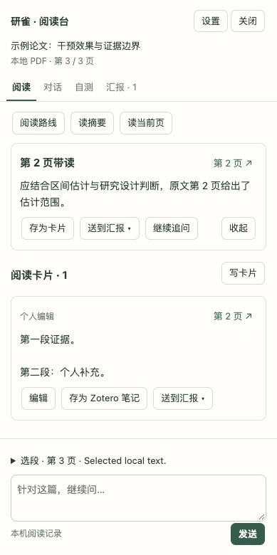

# 研雀 · LitFinch for Zotero

在 Zotero 的 PDF 旁边读论文：AI 带读摘要和当前页，划词精读、翻译、追问，把读到的内容整理成阅读卡片和单篇汇报。阅读记录保存在自己的电脑；AI 使用个人 API，或通过官方 Codex 登录自己的 ChatGPT 订阅。

当前版本 **0.9.0**，支持 Zotero 7—10。

[下载安装包](https://github.com/lvyrana/papermind-zotero/releases/latest) · [版本说明](RELEASE_NOTES.md) · [隐私说明](PRIVACY.md) · [网站与样例](https://papermindapp.com/welcome)



截图使用合成论文和演示回答，来源见[说明](docs/screenshots/README.md)。

## 能做什么

### 带读

- **读摘要**：只用题名和条目摘要，约 200—250 字讲清研究问题、做法和主要发现。
- **读当前页**：约 250—350 字。先用一句话说这页在讲什么，再给最多 3 个要点，标原文页码。
- **阅读路线**：最多 5 步，说明先读哪里、核对哪些证据。
- 回答边生成边显示，可以随时停止；只有完整的回答会保存。

### 划词

在 PDF 中选中文字，浮窗下方会出现研雀的按钮：

- **精读这段**：约 200—300 字，解释这段在讲什么、关键术语，以及它在论证里的作用。
- **翻译**：译文显示在原文下方，不打开侧栏。已经装了其他翻译插件时，可以在设置里隐藏这个按钮。
- **带入追问**：把选段带进对话，接着问。
- **存为卡片**：保存原文和页码，并自动附上中文译文。翻译插件的结果关掉就没了，存成卡片后可以随时回看。

### 卡片、自测与汇报

- 阅读台分为「阅读 · 对话 · 自测 · 汇报」四栏。
- 卡片可以直接在卡片里编辑；点右上角的「第 N 页 ↗」回到 PDF 原处。
- **自测**：AI 出一道需要理解的题，核对你的回答并给出原文页码。
- **汇报**：把带读结果或卡片送进「背景 / 方法 / 发现 / 局限与启发」，整理成单篇汇报。
- 卡片和汇报都可以存为 Zotero 子笔记，跟随 Zotero 自己的同步设置。

## 安装

1. 在 [Releases](https://github.com/lvyrana/papermind-zotero/releases/latest) 下载 `papermind-connector.xpi`。
2. Zotero →「工具」→「插件」→ 右上角齿轮 →「从文件安装插件」，选择下载的文件。
3. 打开一篇带 PDF 的文献，点击顶部工具栏的「研雀」打开阅读台。

升级直接安装新版本即可，原来的阅读记录会保留。想额外备份时，复制 Zotero 配置目录里的 `papermind-reading/` 文件夹。

## 连接 AI

在阅读台点「连接 AI」或「设置」，也可以在 **Zotero → 设置 → 研雀** 里设置。

- **个人 API**（OpenAI 兼容接口）：填写接口地址（包含服务要求的 `/v1` 等路径）和密钥，点「获取可用模型」，分别选择精读模型和翻译模型，也可以手动填写模型名。翻译只处理选中的文字，可以选一个便宜的普通文本模型；留空则沿用精读模型。密钥保存在 Zotero 本机的登录凭据存储中，不写进偏好设置。
- **Codex · ChatGPT 订阅**：先安装[官方 Codex CLI](https://learn.chatgpt.com/docs/cli)，选择 Codex，点「使用 ChatGPT 登录」，在 OpenAI 官方网页完成登录。额度按本人订阅计算。
- **本机模型**：填写 `localhost`、`127.0.0.1` 或 `[::1]` 的 OpenAI 兼容地址。远程服务须使用 HTTPS。

设置里还有两个开关：「划词时显示『翻译』按钮」和「划词存卡片时自动附中文译文」。

## 数据与隐私

- PDF 文件留在 Zotero，不会上传。点击 AI 操作时，只把这一次需要的文字（题名、摘要、当前页、选段及相关节选）直接发给你配置的服务，研雀服务器不经手。
- 卡片、带读、对话、自测和汇报保存在 Zotero 配置目录的 `papermind-reading/`。
- 在阅读台「设置」中可以导出本篇完整阅读记录，换电脑后打开同一条目再恢复。导出文件不含密钥、登录凭据或 PDF。

详见[隐私说明](PRIVACY.md)。

## 开发

```bash
npm ci --ignore-scripts
npm test
npm run test:browser
bash build.sh
node scripts/check-package.mjs papermind-connector.xpi
```

浏览器回归锁定 Playwright 1.62.1，可通过 `PAPERMIND_CHROMIUM_EXECUTABLE` 指定已安装的 Chrome，也可执行 `npx playwright install chromium` 安装测试浏览器。GitHub Actions 运行单元测试、侧栏 / 阅读台 / AI 设置三组浏览器回归、构建和安装包检查。浏览器回归使用合成文献和模拟的服务响应；真实 Zotero 安装与个人账号验收另行记录。

[使用支持](SUPPORT.md) · [安全反馈](SECURITY.md) · [历史变更](CHANGELOG.md) · [第三方声明](THIRD_PARTY_NOTICES.md)

许可：**AGPL-3.0-only**，见 [LICENSE](LICENSE)。
